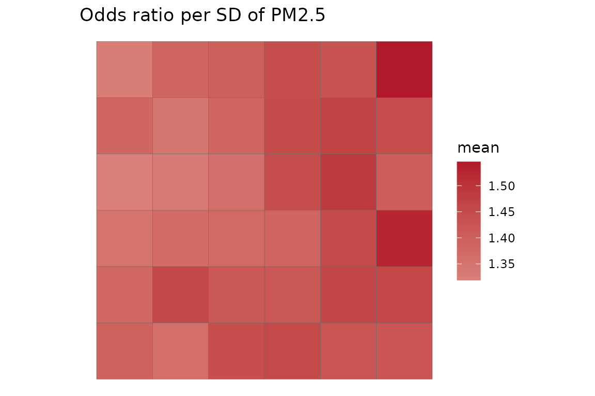
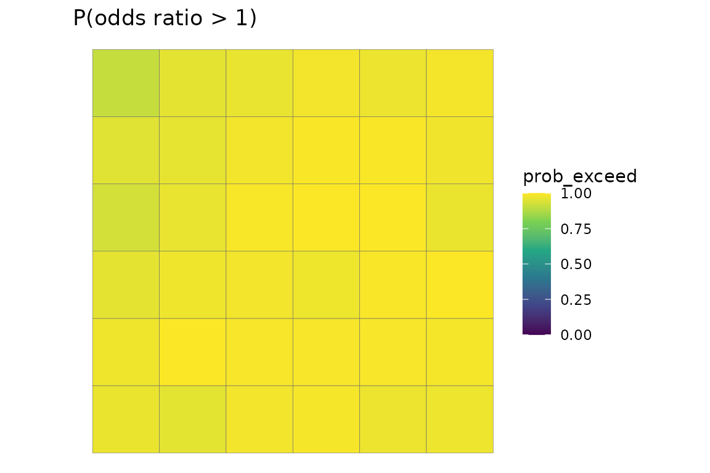

# Getting started with svyexpo

This vignette runs the full workflow on simulated data: a 6 x 6 grid of
areas, 180 clusters displaced as in DHS, and a three-year exposure
raster. With real data, replace
[`svy_simulate()`](https://niiattey.github.io/svyexpo/reference/svy_simulate.md)
with your survey, GPS file, GADM boundaries and exposure rasters.

``` r

library(svyexpo)
sim <- svy_simulate()
head(sim$survey)
#>        id cluster       lon      lat       date weight strata urban age_months
#> 1 C001_01       1 -1.846172 6.171372 2016-06-15      1    A01 FALSE         10
#> 2 C001_02       1 -1.846172 6.171372 2016-06-15      1    A01 FALSE         42
#> 3 C001_03       1 -1.846172 6.171372 2016-06-15      1    A01 FALSE         31
#> 4 C001_04       1 -1.846172 6.171372 2016-06-15      1    A01 FALSE         14
#> 5 C001_05       1 -1.846172 6.171372 2016-06-15      1    A01 FALSE          4
#> 6 C001_06       1 -1.846172 6.171372 2016-06-15      1    A01 FALSE         40
#>   y
#> 1 1
#> 2 1
#> 3 1
#> 4 1
#> 5 1
#> 6 1
```

## 1. Ingest

[`svy_standardize()`](https://niiattey.github.io/svyexpo/reference/svy_standardize.md)
maps your column names to the standard schema. For DHS recodes,
[`svy_from_dhs()`](https://niiattey.github.io/svyexpo/reference/svy_from_dhs.md)
does this in one step from the recode and the GPS dataset.

``` r

pts <- svy_standardize(
  sim$survey,
  id = "id", cluster = "cluster", lon = "lon", lat = "lat",
  date = "date", weight = "weight", strata = "strata", urban = "urban"
)
```

## 2. Boundaries

With real data, download boundaries with
`svy_boundaries("GHA", level = 2)`. Clusters displaced into the sea or
across a border are assigned to the nearest area within `max_dist`
metres.

``` r

pts <- svy_assign_areas(pts, sim$boundaries)
#> 40 points outside all polygons assigned to the nearest area.
table(pts$area_match)
#> 
#> nearest  within 
#>      40    3560
```

## 3. Exposure linkage

Buffers are 2 km for urban and 5 km for rural clusters. Each record gets
the exposure layer for its interview year. Here we also average the
interview year and the year before it.

``` r

buffers <- svy_buffers(pts)
expo <- svy_extract_by_year(buffers, sim$raster, window_years = 2,
                            name = "pm25")
#> Warning: No raster layer(s) for target years 2014; exposure set to NA.
#> ℹ Raster years available: 2014 and 2016.
head(expo)
#>        id exposure_year     pm25
#> 1 C001_01          2016 47.83446
#> 2 C001_02          2016 47.83446
#> 3 C001_03          2016 47.83446
#> 4 C001_04          2016 47.83446
#> 5 C001_05          2016 47.83446
#> 6 C001_06          2016 47.83446
```

`raster` can also be a file path or a Cloud-Optimized GeoTIFF URL
(`"/vsicurl/https://..."`). Only the pixels under the buffers are read,
and `cache_file` in
[`svy_extract()`](https://niiattey.github.io/svyexpo/reference/svy_extract.md)
saves the result so the raster is read once.

## 4. Spatial structure

``` r

graph <- svy_adjacency(sim$boundaries)
graph
#> <svy_graph>: 36 areas, 110 neighbour pairs
#> Neighbours per area: min 3, median 5, max 8
#> Connected components: 1
```

## 5. Model

``` r

dat <- merge(sf::st_drop_geometry(pts), expo, by = "id")
dat$pm25_z <- as.numeric(scale(dat$pm25))

fit <- svy_fit_bym2(
  dat, y ~ pm25_z + urban + age_months, graph,
  family = "binomial", svc = "pm25_z"
)
fit
#> <svy_fit>: binomial BYM2 model, 3600 records, 36 areas
#> Spatially varying coefficients: "pm25_z"
#> 
#> ── Fixed effects
#>                mean     sd 0.025quant 0.975quant
#> (Intercept) -1.3355 0.0928    -1.5181    -1.1538
#> pm25_z       0.3344 0.0881     0.1603     0.5060
#> urbanTRUE    0.1133 0.0866    -0.0566     0.2831
#> age_months   0.0109 0.0022     0.0065     0.0153
#> 
#> ── Hyperparameters
#>                                       mean        sd 0.025quant 0.975quant
#> Precision for svy_area_idx          5.2658    1.6908     2.6959     9.2791
#> Phi for svy_area_idx                0.8759    0.1280     0.5260     0.9970
#> Precision for svy_svc_idx_pm25_z 1333.7073 9096.6703    10.4898  9056.2688
svy_diagnostics(fit)
#>       dic     waic p_eff_waic log_score cpo_failures
#> 1 3982.78 3982.734   30.63776 0.5531588            0
```

## 6. Outputs

``` r

area <- svy_area_effects(fit, exponentiate = TRUE)
slopes <- svy_svc_effects(fit, "pm25_z", exponentiate = TRUE)
head(slopes)
#>   area_id     mean        sd      q025     q500     q975 prob_exceed
#> 1     A01 1.395279 0.2327973 0.9790471 1.384562 1.908332       0.968
#> 2     A02 1.362769 0.2018304 0.9409824 1.360057 1.753704       0.957
#> 3     A03 1.441727 0.2512672 1.0359502 1.414228 2.049632       0.982
#> 4     A04 1.453248 0.2589649 1.0552347 1.418763 2.087006       0.986
#> 5     A05 1.425980 0.2533751 0.9890736 1.404705 2.034142       0.972
#> 6     A06 1.423200 0.2535779 0.9921827 1.402238 1.968430       0.974
```

``` r

svy_map(slopes, sim$boundaries, fill = "mean",
        title = "Odds ratio per SD of PM2.5")
```



``` r

svy_map(slopes, sim$boundaries, fill = "prob_exceed",
        title = "P(odds ratio > 1)")
```


